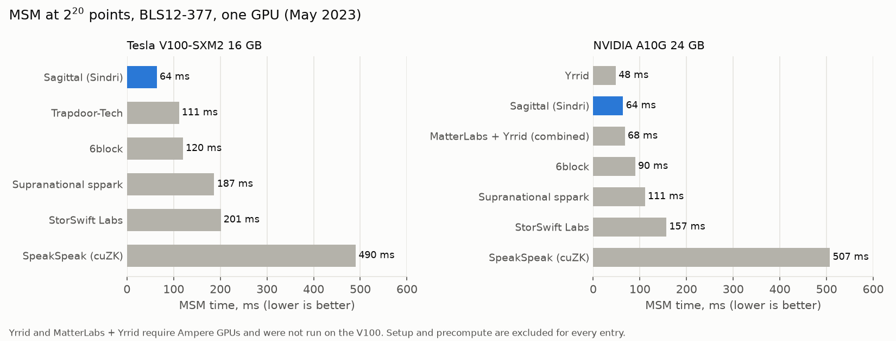
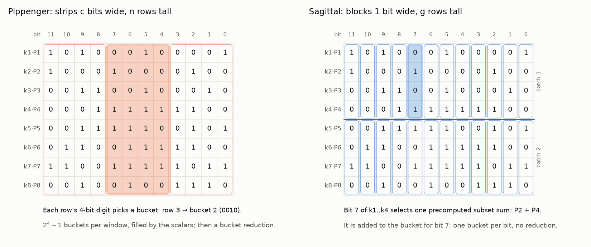
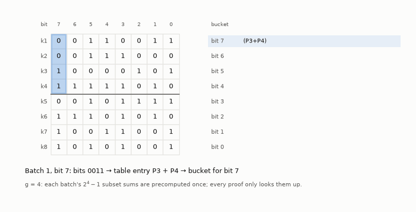
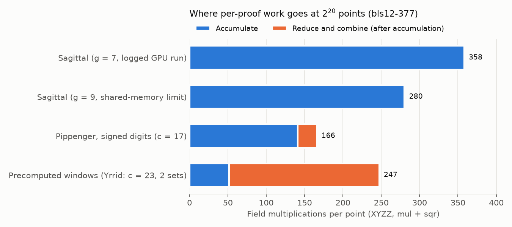

# Sagittal MSM

[](https://github.com/KPreisner/sagittal-msm/actions/workflows/lint.yml)
[](https://github.com/KPreisner/sagittal-msm/actions/workflows/test.yml)
[](LICENSE)

Sagittal is a multi-scalar multiplication (MSM) algorithm for zero-knowledge provers, invented by
Karl Preisner in 2022 and built for GPUs at Sindri Labs in 2023. This repository is a Python
reference implementation that counts every operation, so you can see exactly where the work goes
compared with Pippenger's bucket method and the ZPrize 2022 winners.

▶️ **Interactive walkthrough:** [karl.preisner.us/sagittal-msm](https://karl.preisner.us/sagittal-msm/)
steps through every idea below with animations.

## Result

On BLS12-377 at 2^20 points, with the proving key precomputed once and reused across proofs,
Sagittal ran an MSM in 64 ms: 1.7× faster than every ZPrize 2022 GPU entry that runs on a V100,
and faster than all entries but one (Yrrid, 48 ms) on an A10G.



How each entry was timed, and all sizes including where Sagittal lost:
[Results](docs/6-results.md).

## The idea

Write the scalars as rows of bits. Pippenger's bucket method cuts that matrix into strips c bits
wide and n rows tall. Sagittal cuts it into blocks **1 bit wide and g rows tall**:





A block's g bits select one subset sum of its g points. The points are the proving key, fixed
for every proof, so all subset sums are **precomputed once**. Each proof then does one table
lookup and one addition per (batch, bit), into **one bucket per scalar bit**, and finishes with
about 500 operations. There is no bucket reduction and no data-dependent load, and every
addition is the cheap mixed kind.

## What the counts show

- **Sagittal does more curve operations than a tuned Pippenger** at the sizes that matter: 35.8
  per point at 2^20 (g = 7) against 15.9. Its speed comes from the shape of the work, not from
  doing less of it.
- **Weighted by field cost, the gap narrows.** Against the Yrrid configuration at 2^20 it does
  1.87× more curve operations, but only 1.45× more field multiplications. It was only 1.33× slower on
  the same GPU.
- **Its work parallelizes cleanly.** At 2^20:
  - 253 equally loaded buckets, against Pippenger's 983,040 data-dependent ones;
  - 504 operations after accumulation, against 1.9 million.
- **Memory is the limit.** Tables hold (2^g − 1)/g points per input point, so large MSMs force
  small g. That is where the GPU results stop favoring Sagittal, and the model reproduces the
  batch sizes the 2023 runs had to use.



## Docs

1. [MSM and elliptic-curve arithmetic](docs/1-msm.md): dot products of points, adding points,
   why there is no multiply
2. [Big numbers and GPUs](docs/2-hardware.md): 377-bit arithmetic on 32-bit hardware, GPU memory,
   why data-dependent work is costly
3. [Pippenger's bucket method](docs/3-pippenger.md): the standard approach and its variants
4. [Sagittal MSM](docs/4-sagittal.md): the algorithm, a worked example, costs, prior work
5. [Why Sagittal suits GPUs](docs/5-gpu.md): design goals, the CUDA design, the memory limit
6. [Results](docs/6-results.md): GPU timings, operation counts, precompute, memory
7. [Methodology](docs/7-methodology.md): how every number is produced and tested

[Terms and references](docs/glossary.md): short definitions of every term used, with sources.

## Quick start

You need [uv](https://docs.astral.sh/uv/). [Task](https://taskfile.dev) is optional.

```sh
uv sync
uv run pytest           # or: task py-test
task bench-full         # regenerate benchmarks/results/
```

```python
from sagittal_msm.groups import get_group
from sagittal_msm.inputs import expected_msm, random_points, random_scalars
from sagittal_msm.msm import sagittal

group = get_group("bls12-377-xyzz")  # or bn254-*, goldilocks-*, mock-bls12-377, ...
points, scalars = random_points(group, 64), random_scalars(group, 64)

tables = sagittal.prepare(group, points, batch_size=7)  # once per proving key
result = sagittal.msm(group, tables, scalars)  # every proof
assert group.eq(result, expected_msm(group, points, scalars))

print(group.counter.as_dict())  # curve operations by phase
print(group.field.counter.as_dict())  # field operations by phase
```

## Repository layout

```
src/sagittal_msm/
  msm/          naive.py, sagittal.py, pippenger.py
  groups/       counting group, Jacobian and XYZZ curves, curve constants, registry
  field.py      prime field that counts its operations
  model.py      closed-form expected counts, tested against measured ones
  costs.py      field operations per curve operation
  memory.py     GPU memory model
benchmarks/     batch_size, compare, memory, structure, gpu_2023 (results/ is committed)
scripts/        figures, Goldilocks curve search
docs/           the explainers above
tests/          correctness, exact counts, model validation
```

## License

[PolyForm Strict 1.0.0](LICENSE): free for noncommercial and personal use; no redistribution
or derivative works. For commercial licensing, contact Karl Preisner.

Copyright (c) 2022–2026 Karl Preisner.
