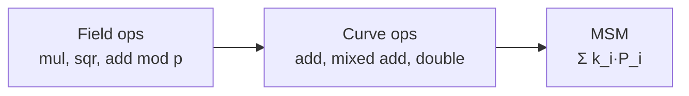

# 1. Multi-scalar multiplication

[Docs index](README.md) · Next: [2. Pippenger's bucket method](2-pippenger.md)

## The problem

Given n elliptic-curve points `P_1 … P_n` and n scalars `k_1 … k_n`, compute

```
Q = k_1·P_1 + k_2·P_2 + … + k_n·P_n
```

This is a **multi-scalar multiplication (MSM)**. It is the most expensive step in many
zero-knowledge provers (Groth16, PLONK and KZG commitments), with n in the millions and
scalars about 253 bits long.

Two properties of the real workload shape everything that follows:

- **The points are fixed.** They come from the proving key (the common reference string), which
  is the same for every proof of a given circuit. Anything computed from the points alone can
  be computed once and reused.
- **The scalars change every proof.** They come from the witness, so per-proof work is what
  matters.

A useful way to see the points: in a KZG-style setup, `P_i = τ^i·G` for a secret τ, so an MSM
with coefficients `c_i` evaluates a polynomial "in the exponent":

```
Σ c_i·(τ^i·G) = (Σ c_i·τ^i)·G = P(τ)·G
```

The prover learns `P(τ)·G` without ever learning τ. The original 2022 prototype of Sagittal
checked its answers exactly this way: evaluate `P(τ)` in the clear with the secret, then
compare.

## What it costs

Points are added with field arithmetic: multiplications and squarings modulo a prime p (377 bits
for BLS12-377). There are three kinds of point operation, and they cost different amounts:

| Operation | What it is | Field multiplications (XYZZ) | (Jacobian) |
|---|---|---|---|
| Mixed add | accumulator + a stored, normalized point | 10 | 11 |
| Full add | accumulator + accumulator | 14 | 16 |
| Double | 2 × accumulator | 9 | 7 |

Counts are multiplications plus squarings from the
[Explicit-Formulas Database](https://hyperelliptic.org/EFD/g1p/auto-shortw.html) formulas this
repo implements. The tests check every one against measured field operations. XYZZ coordinates
are what the fastest GPU MSMs use.



## The naive way

Compute each `k_i·P_i` with double-and-add (one doubling per bit, one addition per set bit),
then sum. For 253-bit scalars that is about 252 doublings and 126 additions per point:
**376 curve operations per point**, measured. Every algorithm in these docs exists to cut that
number, or to make each operation cheaper to run in parallel.

The next page shows the standard answer: [Pippenger's bucket method](2-pippenger.md).
