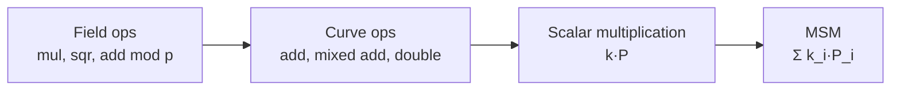
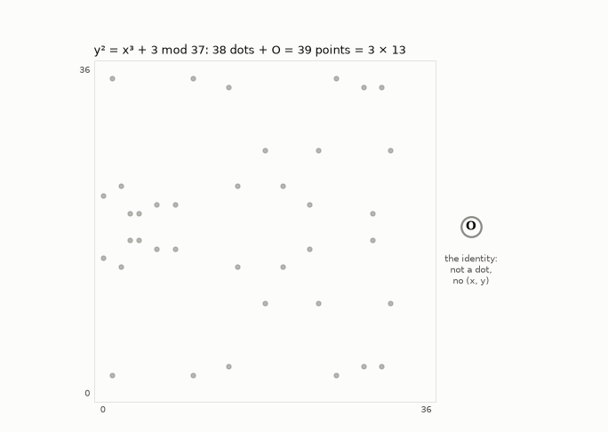
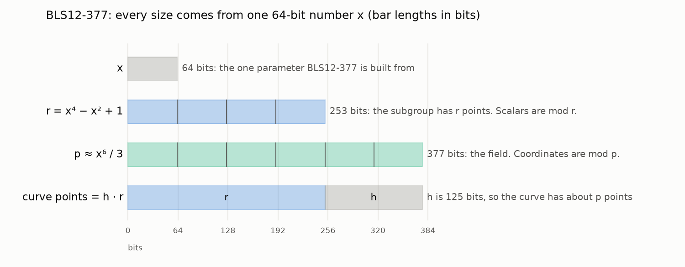

# 1. MSM and elliptic-curve arithmetic

[Docs index](README.md) · Next: [2. Big numbers and GPUs](2-hardware.md)

## A dot product

A dot product multiplies two lists pairwise and adds up the results:

```
(3, 5, 2) · (4, 1, 7) = 3·4 + 5·1 + 2·7 = 12 + 5 + 14 = 31
```

A **multi-scalar multiplication (MSM)** has the same shape, except the second list holds
elliptic-curve points instead of numbers:

```
(k_1, k_2, …, k_n) · (P_1, P_2, …, P_n) = k_1·P_1 + k_2·P_2 + … + k_n·P_n
```

The k_i are **scalars**: ordinary integers. The P_i are **points**: pairs (x, y) of numbers that
satisfy a curve equation. n is the number of points, in the
millions in practice.

**Where MSMs come from.** A [zero-knowledge proof](https://en.wikipedia.org/wiki/Zero-knowledge_proof) lets a prover convince a verifier that a
computation was done correctly without revealing its inputs. Most proof systems in use ([Groth16](https://eprint.iacr.org/2016/260),
[PLONK](https://eprint.iacr.org/2019/953), and anything built on [KZG polynomial commitments](https://dankradfeist.de/ethereum/2020/06/16/kate-polynomial-commitments.html)) commit to large polynomials, and
committing to a polynomial with n coefficients is one MSM of n points. That is why MSMs dominate
proving time.

Two properties of the real workload shape everything that follows:

- **The points are fixed.** They come from the proving key (the common reference string), which
  is the same for every proof of a given circuit. Anything computed from the points alone can
  be computed once and reused.
- **The scalars change every proof.** They come from the witness, so per-proof work is what
  matters.

## Adding two elliptic-curve points

The curves used here have the equation y² = x³ + b for a constant b.
Points on a curve can be added, and the rule has a picture. Over the real numbers, draw the line
through P and Q; it meets the curve at exactly one more point; reflect that point across the
x-axis, and the result is P + Q.


In coordinates, with λ the slope of the line:

```
λ  = (y₂ − y₁) / (x₂ − x₁)
x₃ = λ² − x₁ − x₂
y₃ = λ(x₁ − x₃) − y₁
```

Adding a point to itself (doubling) uses the tangent line instead, with slope λ = 3x₁² / (2y₁).


Cryptography uses the same formulas with every number taken modulo a large prime p. There the
picture becomes a scatter of points (below), but the algebra is identical. There is
also an identity point O (the "point at infinity"): P + O = P, and P + (−P) = O, where −P = (x, −y).

**Division is the expensive part.** Modulo p, dividing means multiplying by an inverse, and an
inverse costs hundreds of multiplications. So implementations keep a running denominator in
extra coordinates and divide only once at the very end:

- **Affine:** plain (x, y).
- **Jacobian:** (X, Y, Z), standing for x = X/Z², y = Y/Z³.
- **XYZZ:** (X, Y, ZZ, ZZZ), standing for x = X/ZZ, y = Y/ZZZ.

That turns one addition into about 10–16 field multiplications:

| Operation | What it is | Field multiplications (XYZZ) | (Jacobian) |
|---|---|---|---|
| Mixed add | accumulator + a stored, normalized point | 10 | 11 |
| Full add | accumulator + accumulator | 14 | 16 |
| Double | 2 × accumulator | 9 | 7 |

Counts are multiplications plus squarings from the
[Explicit-Formulas Database](https://hyperelliptic.org/EFD/g1p/auto-shortw.html) formulas this
repo implements, and the tests check every one against measured field operations. XYZZ is what the
fastest GPU MSMs use.



## There is no multiply for elliptic-curve points

A curve has **only addition**. "k·P" is shorthand for adding P to itself k times:

```
5·P = P + P + P + P + P
```

There is no instruction that multiplies a point by a number, and no way to multiply two points
together. Going backwards, recovering k from k·P, is the [discrete logarithm](https://en.wikipedia.org/wiki/Discrete_logarithm) problem. It is
believed infeasible for these curves, and that is what makes them useful for cryptography.

## A more efficient way to add

In binary, each digit is worth twice the digit to its right: 1, 2, 4, 8, … So 13 is `1101` in
binary: 8 + 4 + 0 + 1. Reading a binary number from the left, each new digit doubles everything read
so far, then adds itself: `1` = 1, `11` = 2·1 + 1 = 3, `110` = 2·3 = 6, `1101` = 2·6 + 1 = 13.

Without a multiply, 13·P means adding P to itself 12 times: P + P + … + P.
**[Double-and-add](https://en.wikipedia.org/wiki/Elliptic_curve_point_multiplication)** follows the binary digits instead: start with P, then for each
remaining digit double what you have (P + P is one addition) and add P if the digit is 1:

| bit | step | value |
|---|---|---|
| 1 | start | P |
| 1 | double, add P | 2P + P = 3P |
| 0 | double | 6P |
| 1 | double, add P | 12P + P = 13P |

That reaches 13·P in **5 additions instead of 12**: 3 doublings and 2 additions of P. The
gap grows fast: for a 20-bit k, about 30 additions instead of up to a million.

## Curves modulo a prime: finite fields and subgroups

Cryptography doesn't use real numbers. It takes every number modulo a prime p, so the coordinates
are whole numbers from 0 to p − 1: a **finite field**. The addition formulas above still work, but
the smooth curve turns into a scatter of about p dots. O isn't one of the dots; it's one extra
point with no coordinates.

Provers don't use every dot. They start at one point G and keep adding G: G, 2G, 3G, … until the
sequence reaches O. That loop is a **subgroup**, and its size is called r. After O the loop
repeats, (r + 1)·G = G, like a clock with r hours, so a scalar k only matters mod r. Here it is
on y² = x³ + 3 with p = 37, which has 39 = 3 × 13 points:



r is prime on purpose: then every point in the loop except O leads around the whole loop, and an
attacker can't split the problem into smaller pieces.

## A real curve: BLS12-377

Everything here uses [BLS12-377](https://eips.ethereum.org/EIPS/eip-2539) (introduced in the [Zexe paper](https://eprint.iacr.org/2018/962)), the curve of
the ZPrize MSM competition. Its equation is y² = x³ + 1 ([BN254](https://eips.ethereum.org/EIPS/eip-197), another common curve, uses
y² = x³ + 3, the same equation as the tiny example above). Its two primes are far too big to draw:

- **p, 377 bits.** Coordinates are numbers modulo p. In full, p is the 114-digit number
  `258664426012969094010652733694893533536393512754914660539884262666720468348340822774968888139573360124440321458177`.
- **r, 253 bits.** The subgroup provers use has r points, and scalars are numbers modulo r. In
  full, r is the 76-digit number `8444461749428370424248824938781546531375899335154063827935233455917409239041`.

So a scalar has 253 bits, and double-and-add takes about 252 doublings and 126 additions:
**376 curve operations per point**, measured.

**The details.** The curve has h·r points, about p of them
([Hasse's theorem](https://en.wikipedia.org/wiki/Hasse%27s_theorem_on_elliptic_curves)), with a 125-bit cofactor h. The discrete logarithm is only as hard
as the largest prime factor of the group's order ([Pohlig–Hellman](https://en.wikipedia.org/wiki/Pohlig%E2%80%93Hellman_algorithm)), which is why provers
use the prime-order subgroup. The sizes come from how BLS12 curves are built: from one 64-bit
number x, r = x⁴ − x² + 1 (253 bits) and p ≈ x⁶/3 (377 bits). BLS12-377's x was also chosen so
that 2⁴⁷ divides r − 1, which the [NTTs](https://en.wikipedia.org/wiki/Discrete_Fourier_transform_over_a_ring#Number-theoretic_transform) (FFTs over a finite field) inside provers need.



## The naive MSM

Do one double-and-add per point, then add up the n results: about 376·n curve operations. At
n = 2^20 that is about 400 million curve operations, each costing 10–16 field multiplications.
Each of those is itself hundreds of machine instructions, as the [next page](2-hardware.md)
shows.

A useful way to see the fixed points: in a KZG-style setup, `P_i = τ^i·G` for a secret τ, so an
MSM with coefficients `c_i` evaluates a polynomial "in the exponent":

```
Σ c_i·(τ^i·G) = (Σ c_i·τ^i)·G = P(τ)·G
```

The prover computes `P(τ)·G` without ever learning τ. The original 2022 prototype of Sagittal
checked its answers exactly this way: evaluate `P(τ)` in the clear with the secret, then compare.

[Docs index](README.md) · Next: [2. Big numbers and GPUs](2-hardware.md)
