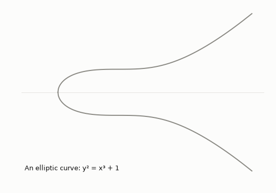
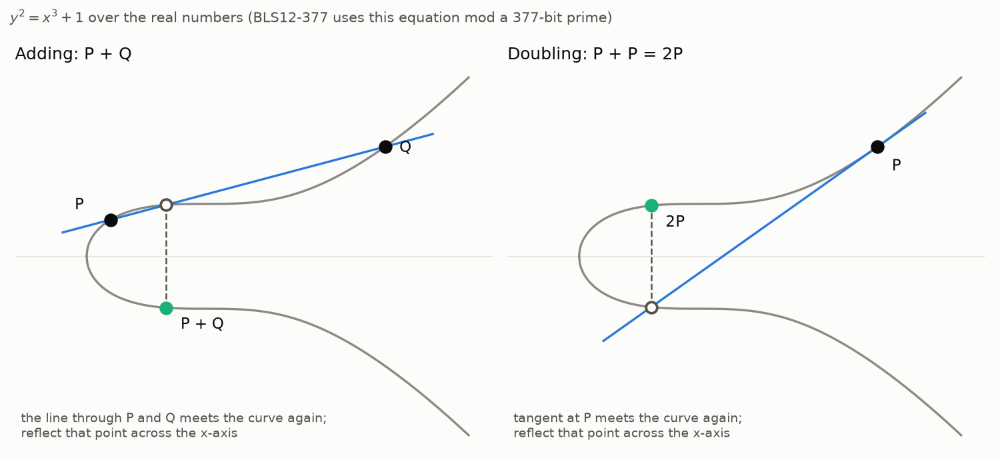
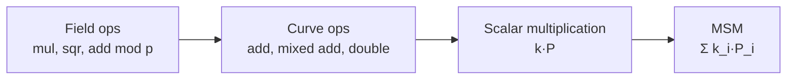

# 1. MSM and elliptic-curve arithmetic

[Docs index](README.md) · Next: [2. Big numbers and GPUs](2-hardware.md)

## A dot product

A dot product multiplies two lists pairwise and adds up the results:

```
(3, 5, 2) · (4, 1, 7) = 3·4 + 5·1 + 2·7 = 12 + 5 + 14 = 31
```

A **multi-scalar multiplication (MSM)** has the same shape, except the second list holds
elliptic-curve points instead of numbers:

```
(k_1, k_2, …, k_n) · (P_1, P_2, …, P_n) = k_1·P_1 + k_2·P_2 + … + k_n·P_n
```

The k_i are **scalars**: ordinary integers, about 253 bits long. The P_i are **points**: pairs
(x, y) of 377-bit numbers that satisfy a curve equation. n is the number of points, in the
millions in practice.

**Where MSMs come from.** A [zero-knowledge proof](https://en.wikipedia.org/wiki/Zero-knowledge_proof) lets a prover convince a verifier that a
computation was done correctly without revealing its inputs. Most proof systems in use ([Groth16](https://eprint.iacr.org/2016/260),
[PLONK](https://eprint.iacr.org/2019/953), and anything built on [KZG polynomial commitments](https://dankradfeist.de/ethereum/2020/06/16/kate-polynomial-commitments.html)) commit to large polynomials, and
committing to a polynomial with n coefficients is one MSM of n points. That is why MSMs dominate
proving time.

**Why 253 bits and 377 bits?** There are two different primes. Coordinates are numbers modulo p,
a 377-bit prime: the field. The points themselves form a group with r elements, where r is a
253-bit prime, so adding any point to itself r times gives the identity point O (below) and only
k mod r matters. Scalars are numbers modulo r; coordinates are numbers modulo p.

Two properties of the real workload shape everything that follows:

- **The points are fixed.** They come from the proving key (the common reference string), which
  is the same for every proof of a given circuit. Anything computed from the points alone can
  be computed once and reused.
- **The scalars change every proof.** They come from the witness, so per-proof work is what
  matters.

## Adding two points

The curves used here have the equation y² = x³ + b: b = 1 for [BLS12-377](https://eprint.iacr.org/2018/962) and b = 3 for [BN254](https://eips.ethereum.org/EIPS/eip-197).
Points on a curve can be added, and the rule has a picture. Over the real numbers, draw the line
through P and Q; it meets the curve at exactly one more point; reflect that point across the
x-axis, and the result is P + Q.



In coordinates, with λ the slope of the line:

```
λ  = (y₂ − y₁) / (x₂ − x₁)
x₃ = λ² − x₁ − x₂
y₃ = λ(x₁ − x₃) − y₁
```

Adding a point to itself (doubling) uses the tangent line instead, with slope λ = 3x₁² / (2y₁).



Real curves use the same formulas with every number taken modulo a large prime p (377 bits for
BLS12-377). There the picture becomes a scatter of points, but the algebra is identical. There is
also an identity point O (the "point at infinity"): P + O = P, and P + (−P) = O, where −P = (x, −y).

**Division is the expensive part.** Modulo p, dividing means multiplying by an inverse, and an
inverse costs hundreds of multiplications. So implementations keep a running denominator in
extra coordinates and divide only once at the very end:

- **Affine:** plain (x, y).
- **Jacobian:** (X, Y, Z), standing for x = X/Z², y = Y/Z³.
- **XYZZ:** (X, Y, ZZ, ZZZ), standing for x = X/ZZ, y = Y/ZZZ.

That turns one addition into about 10–16 field multiplications:

| Operation | What it is | Field multiplications (XYZZ) | (Jacobian) |
|---|---|---|---|
| Mixed add | accumulator + a stored, normalized point | 10 | 11 |
| Full add | accumulator + accumulator | 14 | 16 |
| Double | 2 × accumulator | 9 | 7 |

Counts are multiplications plus squarings from the
[Explicit-Formulas Database](https://hyperelliptic.org/EFD/g1p/auto-shortw.html) formulas this
repo implements, and the tests check every one against measured field operations. XYZZ is what the
fastest GPU MSMs use.

### What the GPU code actually computed: Jacobian coordinates in Montgomery form

Sagittal's benchmarked CUDA kernel kept its buckets in **Jacobian coordinates**. A point is
stored as (X, Y, Z) and stands for the affine point x = X/Z², y = Y/Z³, so the denominators ride
along in Z and nothing is divided until the very end. Table entries are stored affine (Z = 1), so
adding one to a bucket is a **mixed add**. The kernel used sppark's point type, which implements
the same formulas as this repo's `JacobianGroup`:

```
Mixed add: (X1, Y1, Z1) + (x2, y2)               7M + 4S
  Z1Z1 = Z1²
  U2   = x2 · Z1Z1                               x2 scaled to the bucket's denominator
  S2   = y2 · Z1 · Z1Z1                          y2 scaled likewise
  H    = U2 − X1                                 the x-difference (λ's denominator)
  HH   = H²
  I    = 4 · HH
  J    = H · I
  r    = 2 · (S2 − Y1)                           the y-difference (λ's numerator)
  V    = X1 · I
  X3   = r² − J − 2·V
  Y3   = r · (V − X3) − 2 · Y1 · J
  Z3   = (Z1 + H)² − Z1Z1 − HH                   = 2·Z1·H, the new denominator

Double: 2·(X1, Y1, Z1)                           2M + 5S
  A  = X1²,  B = Y1²,  C = B²
  D  = 2 · ((X1 + B)² − A − C)                   = 4·X1·B
  E  = 3 · A                                     3x² from the tangent slope 3x²/(2y)
  F  = E²
  X3 = F − 2·D
  Y3 = E · (D − X3) − 8·C
  Z3 = 2 · Y1 · Z1
```

They are the affine formulas above with every division replaced by multiplying the other side
through by Z. M is a field multiplication and S a squaring. In the
[Explicit-Formulas Database](https://hyperelliptic.org/EFD/g1p/auto-shortw-jacobian-0.html), the
standard catalog of these formulas, they are listed as `madd-2007-bl` (mixed addition, Bernstein
and Lange, 2007) and `dbl-2009-l` (doubling, Lange, 2009); sppark's source cites the same IDs.

**Every value in those formulas is in Montgomery form**, a·R mod p
([2. Big numbers and GPUs](2-hardware.md) explains why). That changes nothing in the formulas:
- every product or square is one Montgomery multiplication (about 300 word multiply-adds);
- additions, subtractions and small multiples (2·, 3·, 4·, 8·) are ordinary modular additions;
- values enter Montgomery form once when the points are loaded, and leave it once when the
  final result is converted back to an affine point.



## There is no multiply

A curve has **only addition**. "k·P" is shorthand for adding P to itself k times:

```
5·P = P + P + P + P + P
```

There is no instruction that multiplies a point by a number, and no way to multiply two points
together. Going backwards, recovering k from k·P, is the [discrete logarithm](https://en.wikipedia.org/wiki/Discrete_logarithm) problem. It is
believed infeasible for these curves, and that is what makes them useful for cryptography.

Adding P to itself 2²⁵³ times is impossible, so scalar multiplication uses **[double-and-add](https://en.wikipedia.org/wiki/Elliptic_curve_point_multiplication)**:
read k's bits from the top, double at every bit and add P at every 1 bit. For k = 13 = 1101 in
binary:

| bit | step | value |
|---|---|---|
| 1 | start | P |
| 1 | double, add P | 2P + P = 3P |
| 0 | double | 6P |
| 1 | double, add P | 12P + P = 13P |

That is 3 doublings and 2 additions instead of 12 additions. A 253-bit scalar takes about
252 doublings and 126 additions: **376 curve operations per point**, measured.

## The naive MSM

Do one double-and-add per point, then add up the n results: about 376·n curve operations. At
n = 2^20 that is about 400 million curve operations, each costing 10–16 field multiplications.
Each of those is itself hundreds of machine instructions, as the [next page](2-hardware.md)
shows.

A useful way to see the fixed points: in a KZG-style setup, `P_i = τ^i·G` for a secret τ, so an
MSM with coefficients `c_i` evaluates a polynomial "in the exponent":

```
Σ c_i·(τ^i·G) = (Σ c_i·τ^i)·G = P(τ)·G
```

The prover computes `P(τ)·G` without ever learning τ. The original 2022 prototype of Sagittal
checked its answers exactly this way: evaluate `P(τ)` in the clear with the secret, then compare.

[Docs index](README.md) · Next: [2. Big numbers and GPUs](2-hardware.md)
