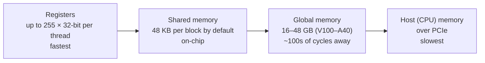
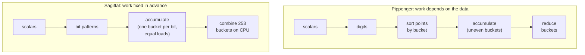

# 2. Big numbers and GPUs

[Docs index](README.md) · Previous: [1. MSM](1-msm.md) · Next: [3. Pippenger](3-pippenger.md)

Counting curve operations is only half the story. This page covers what one operation costs in
hardware, and why GPUs reward some algorithms over others.

## Numbers bigger than a machine word

A **machine word** is the size of number a processor handles in one instruction: **64 bits** on a
modern CPU and **32 bits** for a GPU's integer units. A 64-bit word holds numbers up to about
1.8 × 10¹⁹. A 377-bit field element is far bigger (up to about 10¹¹³), so it is stored as an
array of words, called limbs: 6 words on a CPU, **12 on a GPU**.

Arithmetic then happens word by word, like long multiplication on paper:

- **Multiplying** two 12-word numbers takes 12 × 12 = 144 word multiplications, with carries
  passed from each partial product to the next.
- **Reducing** the 24-word result mod p takes about as many again. The usual method (Montgomery
  multiplication, CIOS variant) totals 2s² + s = **300 word multiply-adds for s = 12**.
- **Montgomery form** stores each value as a·R mod p, which lets reduction use multiplications
  and shifts instead of division. Sindri's GPU code kept points in projective coordinates in
  Montgomery form.
- **A curve operation multiplies that again.** A mixed add is 10 field multiplications, so about
  **3,000 word multiply-adds**, plus additions and carry handling.

The sizes add up in memory too. On BLS12-377:

| Value | Words (32-bit) | Bytes |
|---|---|---|
| Scalar | 8 | 32 |
| Affine point (x, y) | 24 | 96 |
| XYZZ accumulator (X, Y, ZZ, ZZZ) | 48 | 192 |
| 2^20 input points | | 96 MiB |

## A GPU in brief

A GPU runs thousands of threads at once in groups of 32 called **warps**. A warp executes one
instruction at a time for all 32 threads together. If threads in a warp need to do different
things (an `if` that goes different ways, or loops of different length), the warp runs each path
in turn while the other threads wait. This is called **divergence**.

Memory comes in tiers, from small and fast to large and slow:

- **Registers.** One XYZZ accumulator takes 48 of a thread's 255 registers, and an addition
  needs several temporaries on top. The more registers each thread uses, the fewer threads fit
  on the chip at once, and the less the GPU can hide memory delays by switching between them.
- **Shared memory.** Small, fast, and shared by the threads of one block. It is the natural place
  for data many threads read, like Sagittal's per-batch tables: 48 KB holds a table for g ≤ 9.
- **Global memory.** Large but slow. It holds the points, scalars and precomputed data. At large
  n it fills up: on a 16 GiB V100, the points and scalars for 2^26 points alone take 8.6 GB.

## Why data-dependent work is costly on a GPU

In Pippenger's bucket method ([next page](3-pippenger.md)), the bucket a point goes to depends on
its scalar. Whatever the GPU does with that, it costs something:

- **Thousands of threads may target the same bucket.** Adding into a bucket is a curve addition
  (about 3,000 multiply-adds), not a single instruction, so the hardware's atomic add can't do
  it. Threads have to take a lock (and wait in line), or the work has to be rearranged first.
- **Rearranging means sorting.** Fast implementations first sort points by bucket, so each bucket's
  points are processed together. That is extra full passes over memory, every proof.
- **Bucket sizes are uneven.** Some buckets get many more points than others. Threads in a warp
  that finish early wait for the slowest, so implementations sort or split buckets by size to
  balance the work. Yrrid, the ZPrize 2022 winner, sorted buckets so the largest run first.
- **Reduction waits for accumulation.** Combining buckets can only start once every bucket is
  final, which adds a synchronization point and a second phase of work.

These queues, sorts and schedulers work. The ZPrize winners do them very well and are fastest at
large n. But they are overhead: memory traffic, synchronization and code. An algorithm whose work
is fixed in advance doesn't pay them.

[Docs index](README.md) · Previous: [1. MSM](1-msm.md) · Next: [3. Pippenger](3-pippenger.md)
