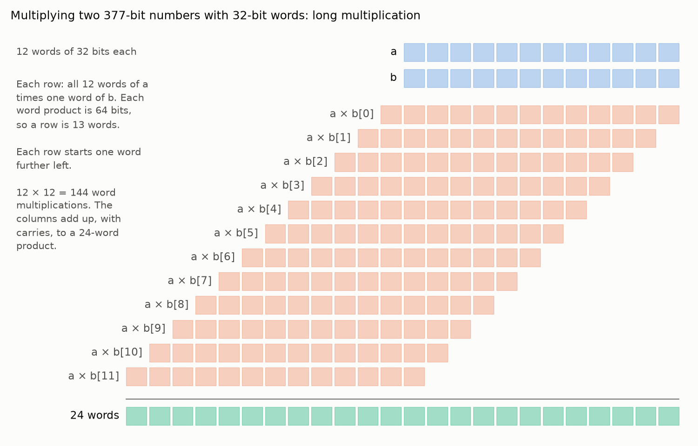
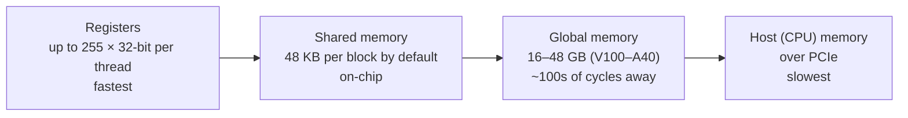
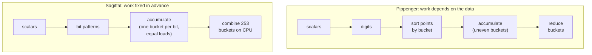

# 2. Big numbers and GPUs

[Docs index](README.md) · Previous: [1. MSM](1-msm.md) · Next: [3. Pippenger](3-pippenger.md)

Counting curve operations is only half the story. This page covers what one operation costs in
hardware, and why GPUs reward some algorithms over others.

## Numbers bigger than a machine word

A **machine word** is the size of number a processor handles in one instruction: **64 bits** on a
modern CPU and **32 bits** for a GPU's integer units. A 64-bit word holds numbers up to about
1.8 × 10¹⁹. A 377-bit field element is far bigger (up to about 10¹¹³), so it is stored as an
array of words, called limbs: 6 words on a CPU, **12 on a GPU**.

Multiplying happens word by word, like long multiplication on paper. Two 12-word numbers take
12 × 12 = 144 word multiplications, with carries passed from each partial product to the next:



## Division is the expensive part

Adding and multiplying big numbers both work word by word, and the words can be worked on side
by side. Division can't. Long division finds the answer one word at a time: guess the next word
of the quotient, multiply the whole divisor by the guess, subtract, fix the guess if it was off,
and only then move on to the next word. Every step waits on the one before, and even dividing
two single words is slow (a GPU has no integer divide instruction at all; the compiler builds
one out of other instructions).

Curve arithmetic would need to divide in two places, at two different levels, and
implementations avoid each with a separate trick:

- **Inside every field multiplication.** Multiplying two 12-word numbers gives 24 words (754
  bits), which have to be reduced mod p back to 12. The remainder mod p is what's left after a
  long division by p. **Montgomery form** changes how each *single coordinate* (an x or a y on
  its own) is stored, so reducing becomes chopping off the low words instead of a long
  division by p.
- **Inside every point addition.** The slope λ from [1. MSM](1-msm.md) is a fraction.
  **Jacobian and XYZZ coordinates** change how each *point* (the (x, y) pair) is stored, so an
  addition never divides.

The two tricks stack: a point in Jacobian coordinates is three numbers, and each of those
numbers is stored in Montgomery form.

### Reducing without dividing: Montgomery form

Dividing by 1,000 is easy in decimal: chop off the last three digits. Dividing by a power of 2 is
just as easy for a computer: chop off the low words. Reducing mod p is hard only because p isn't
a power of 2. [Montgomery form](https://en.wikipedia.org/wiki/Montgomery_modular_multiplication) rearranges the arithmetic so the division it needs is by
R = 2³⁸⁴ (exactly 12 words) instead of by p.

Each number a is stored as a·R mod p. Multiplying two stored numbers gives aR · bR = abR², but
the stored form of the answer is abR, so there is one factor of R too many: divide by R. The
product usually isn't a multiple of R, but adding a multiple of p changes nothing mod p. So
first add the multiple of p that makes the low 12 words zero (finding it takes a few more
multiplications), then chop them off.

A toy version, mod 7 with R = 10: 3 is stored as 30 mod 7 = 2, and 2 is stored as 20 mod 7 = 6.
Multiplying the stored values gives 2 · 6 = 12. Adding 4 · 7 makes it 40, a multiple of 10, and
chopping off the 0 leaves 4. That is the stored form of 3 · 2 = 6, since 60 mod 7 = 4, and
nothing was divided by 7.

Numbers are converted into Montgomery form once at the start and out once at the end;
everything in between stays in it. Sindri's GPU code kept every field element in Montgomery
form.

**CIOS** (Coarsely Integrated Operand Scanning, [Koç, Acar and Kaliski, 1996](https://doi.org/10.1109/40.502403)) is the most common
way to compute one Montgomery multiplication. It interleaves multiplying and reducing word by
word, so the running result never grows past 14 words. It takes 2s² + s word multiply-adds for
s words: **300 for s = 12**, about twice the 144 of the plain product, because finding and
adding the multiple of p costs about as much as the product itself.

### Adding points without dividing: Jacobian and XYZZ coordinates

The slope λ divides by x₂ − x₁. Modulo p there are no fractions, so dividing by a number means
multiplying by its **inverse**: the number that gives 1 when multiplied by it. Mod 7, the inverse
of 3 is 5, because 3 · 5 = 15 = 2·7 + 1. For a 377-bit p, finding an inverse costs hundreds of
field multiplications, more than the rest of the addition put together, and an MSM does millions
of additions.

The fix is the one you use for fractions on paper: 1/3 + 1/5 = 8/15 needs no division if you
keep the top and bottom separately. So each point carries its denominator along with it, as an
extra number called **Z**:

1. **Start with denominator 1.** An input point (x, y) becomes (X, Y, Z) = (x, y, 1).
2. **Don't divide; grow Z.** Each addition would divide by the slope's denominator. Instead,
   that factor is multiplied into Z, and X and Y are scaled to match. Z keeps track of every
   denominator the additions skipped.
3. **Divide once at the end.** After millions of additions, one inverse of Z turns the result
   back into a plain (x, y).

Why x = X/Z² and y = Y/Z³, rather than X/Z and Y/Z? Look at the formulas from
[1. MSM](1-msm.md). x₃ = λ² − x₁ − x₂ contains λ², so its denominator is the slope's denominator
squared. y₃ = λ(x₁ − x₃) − y₁ multiplies λ by something containing x₃, so its denominator is the
cube. Putting x over Z² and y over Z³ matches what the formulas produce anyway, so nothing has to
be multiplied up to line them up. This is **Jacobian** coordinates; plain (x, y) is called
**affine**.

**XYZZ** coordinates store the two denominators directly: (X, Y, ZZ, ZZZ) with x = X/ZZ and
y = Y/ZZZ, where ZZ plays the role of Z² and ZZZ of Z³. That takes one more number per point but
saves recomputing squares and cubes in every addition, and the fastest GPU MSMs use it.

An MSM adds points into running sums, called **accumulators**, and those carry a denominator.
The input points, and Sagittal's precomputed tables, are stored affine. Adding an affine point to
an accumulator is a **mixed add**, and it is the cheapest addition, because Z = 1 makes several
multiplications disappear. Each operation costs about 10–16 field multiplications, and no
inverses:

| Operation | What it adds | Field multiplications (XYZZ) | (Jacobian) |
|---|---|---|---|
| Mixed add | an accumulator + a stored affine point | 10 | 11 |
| Full add | two accumulators | 14 | 16 |
| Double | an accumulator + itself | 9 | 7 |

Counts are multiplications plus squarings from the
[Explicit-Formulas Database](https://hyperelliptic.org/EFD/g1p/auto-shortw.html) formulas this
repo implements, and the tests check every one against measured field operations. At 300 word
multiply-adds per field multiplication, one mixed add is about **3,000 word multiply-adds**, plus
additions and carry handling.

The sizes add up in memory too. On BLS12-377:

| Value | Words (32-bit) | Bytes |
|---|---|---|
| Scalar | 8 | 32 |
| Affine point (x, y) | 24 | 96 |
| XYZZ accumulator (X, Y, ZZ, ZZZ) | 48 | 192 |
| 2^20 input points | | 96 MiB |

### What the GPU code actually computed: Jacobian coordinates in Montgomery form

Sagittal's benchmarked CUDA kernel kept its buckets in **Jacobian coordinates**. A point is
stored as (X, Y, Z) and stands for the affine point x = X/Z², y = Y/Z³, so the denominators ride
along in Z and nothing is divided until the very end. Table entries are stored affine (Z = 1), so
adding one to a bucket is a **mixed add** (above). The kernel used sppark's point type, which implements
the same formulas as this repo's `JacobianGroup`:

```
Mixed add: (X1, Y1, Z1) + (x2, y2)               7M + 4S
  Z1Z1 = Z1²
  U2   = x2 · Z1Z1                               x2 scaled to the bucket's denominator
  S2   = y2 · Z1 · Z1Z1                          y2 scaled likewise
  H    = U2 − X1                                 the x-difference (λ's denominator)
  HH   = H²
  I    = 4 · HH
  J    = H · I
  r    = 2 · (S2 − Y1)                           the y-difference (λ's numerator)
  V    = X1 · I
  X3   = r² − J − 2·V
  Y3   = r · (V − X3) − 2 · Y1 · J
  Z3   = (Z1 + H)² − Z1Z1 − HH                   = 2·Z1·H, the new denominator

Double: 2·(X1, Y1, Z1)                           2M + 5S
  A  = X1²,  B = Y1²,  C = B²
  D  = 2 · ((X1 + B)² − A − C)                   = 4·X1·B
  E  = 3 · A                                     3x² from the tangent slope 3x²/(2y)
  F  = E²
  X3 = F − 2·D
  Y3 = E · (D − X3) − 8·C
  Z3 = 2 · Y1 · Z1
```

They are the affine formulas from [1. MSM](1-msm.md) with every division replaced by multiplying the other side
through by Z. M is a field multiplication and S a squaring. In the
[Explicit-Formulas Database](https://hyperelliptic.org/EFD/g1p/auto-shortw-jacobian-0.html), the
standard catalog of these formulas, they are listed as `madd-2007-bl` (mixed addition, Bernstein
and Lange, 2007) and `dbl-2009-l` (doubling, Lange, 2009); sppark's source cites the same IDs.

**Every value in those formulas is in Montgomery form**, a·R mod p
(above). That changes nothing in the formulas:
- every product or square is one Montgomery multiplication (about 300 word multiply-adds);
- additions, subtractions and small multiples (2·, 3·, 4·, 8·) are ordinary modular additions;
- values enter Montgomery form once when the points are loaded, and leave it once when the
  final result is converted back to an affine point.

## A GPU in brief

A GPU program is called a **kernel** ([CUDA programming guide](https://docs.nvidia.com/cuda/cuda-c-programming-guide/)). It runs as thousands of threads, organized two ways:
**thread blocks** of up to 1,024 threads that share fast on-chip memory and can wait for each
other, and **warps** of 32 threads. A warp executes one instruction at a time for all 32 threads
together. If threads in a warp need to do different
things (an `if` that goes different ways, or loops of different length), the warp runs each path
in turn while the other threads wait. This is called **divergence**.

Memory comes in tiers, from small and fast to large and slow:



- **Registers.** One XYZZ accumulator takes 48 of a thread's 255 registers, and an addition
  needs several temporaries on top. The more registers each thread uses, the fewer threads fit
  on the chip at once, and the less the GPU can hide memory delays by switching between them.
- **Shared memory.** Small, fast, and shared by the threads of one block. It is the natural place
  for data many threads read, like Sagittal's per-batch tables: 48 KB holds a table for g ≤ 9.
- **Global memory.** Large but slow. It holds the points, scalars and precomputed data. At large
  n it fills up: on a 16 GiB V100, the points and scalars for 2^26 points alone take 8.6 GB.

## Why data-dependent work is costly on a GPU

In Pippenger's bucket method ([next page](3-pippenger.md)), the bucket a point goes to depends on
its scalar. Whatever the GPU does with that, it costs something:

- **Thousands of threads may target the same bucket.** Adding into a bucket is a curve addition
  (about 3,000 multiply-adds), not a single instruction, so the hardware's **atomic add** (an
  instruction that lets many threads add to the same number without losing updates) can't do
  it. Threads have to take a lock (and wait in line), or the work has to be rearranged first.
- **Rearranging means sorting.** Fast implementations first sort points by bucket, so each bucket's
  points are processed together. That is extra full passes over memory, every proof.
- **Bucket sizes are uneven.** Some buckets get many more points than others. Threads in a warp
  that finish early wait for the slowest, so implementations sort or split buckets by size to
  balance the work. Yrrid, the ZPrize 2022 winner, sorted buckets so the largest run first.
- **Reduction waits for accumulation.** Combining buckets can only start once every bucket is
  final, which adds a synchronization point and a second phase of work.

These queues, sorts and schedulers work. The ZPrize winners do them very well and are fastest at
large n. But they are overhead: memory traffic, synchronization and code. An algorithm whose work
is fixed in advance doesn't pay them.



[Docs index](README.md) · Previous: [1. MSM](1-msm.md) · Next: [3. Pippenger](3-pippenger.md)
