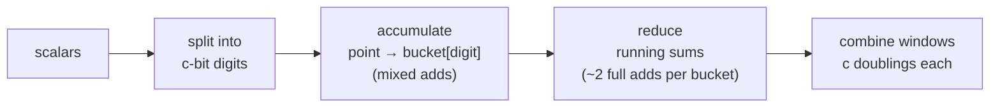
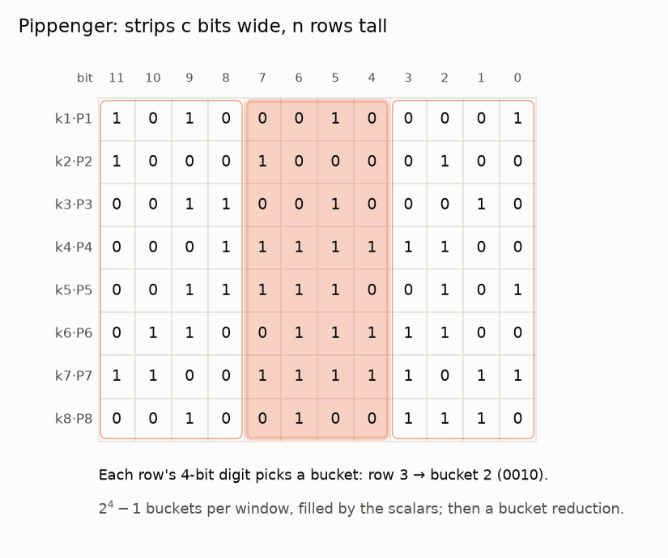

# 3. Pippenger's bucket method

[Docs index](README.md) · Previous: [2. Big numbers and GPUs](2-hardware.md) · Next: [4. Sagittal](4-sagittal.md)

Every fast MSM, including the [ZPrize 2022 winners](https://www.zprize.io/blog/announcing-zprize-results), is built on the bucket method ([Bernstein on Pippenger](https://cr.yp.to/papers/pippenger.pdf)). Sagittal is
easiest to understand as a different way of slicing the same picture.

## Windows and buckets

With n points, write every scalar in base 2^c: a 253-bit scalar becomes W = ⌈253 / c⌉ digits
of c bits each.
For one window (one digit position), every point goes into the **bucket** for its digit:

```
bucket[d] = sum of all P_i whose digit in this window is d     (d = 1 … 2^c - 1)
```

The window's contribution is `Σ d·bucket[d]`. That needs no multiplications: a **running sum**
from the top bucket down gives it in about two additions per bucket.

```
running = B3              total = B3
running = B3 + B2         total = 2·B3 + B2
running = B3 + B2 + B1    total = 3·B3 + 2·B2 + B1   ✓
```

Finally the windows are combined like a long-hand number: double c times, add the next window.





*Each row is one scalar in binary. A window is a strip c bits wide and n rows tall (here c = 4).
Every row's digit in the highlighted window picks one of 2^c − 1 buckets.*

## Cost and the choice of window size c

```
accumulate ≈ W · n         (one mixed add per point per window)
reduce     ≈ W · 2 · 2^c   (two full adds per bucket per window)
```

Bigger windows mean fewer windows (less accumulation) but exponentially more buckets (more
reduction). The best c balances the two and **grows with n**: c = 10 at 2^12 points, 17 at 2^20,
21 at 2^24 (signed digits, 253-bit scalars). So Pippenger's cost per point keeps falling as n
grows: 28.9 curve operations per point at 2^12, 15.9 at 2^20, 13.3 at 2^24.

## Variants this repo implements

- **[Signed digits](glossary.md).** Digits in (−2^(c−1), 2^(c−1)] instead of [0, 2^c). A negative
  digit adds the negated point, which costs a single field subtraction (flip the sign of y). This
  halves the bucket count, to 2^(c−1) per window, and the reduction.
- **Precomputed windows.** Store shifted copies `2^(j·s·c)·P_i` of every point. Then window w of
  `P_i` is just window `w mod s` of a copy, so all W windows fold into s bucket sets: fewer
  reductions and doublings, paid for once with precomputed doublings. This is how the ZPrize 2022
  winners worked. [Yrrid](https://github.com/yrrid/submission-msm-gpu) ([all entries](https://github.com/z-prize/2022-entries/tree/main/open-division/prize1-msm/prize1a-msm-gpu))
  used c = 23, signed digits and 2 bucket sets, tuned for batches of 2^26 points.

All three come from one implementation, [`msm/pippenger.py`](../src/sagittal_msm/msm/pippenger.py).
Plain Pippenger is the case with no copies.

## What a GPU has to deal with

Pippenger's buckets are filled by the scalars, so on a GPU:

- **There are many buckets.** At 2^20 with c = 17, signed digits: 15 windows × 65,536 buckets
  ≈ 983,000 accumulators (65,536 is 2^16, not 2^17, because signed digits halve the buckets).
- **Their loads depend on the data.** Some buckets get far more points than others (and with
  textbook signed digits, the top window can send a large share of all points to one bucket).
  Fast GPU codes sort buckets by size and split the heavy ones.
- **The reduction waits for accumulation.** Bucket reduction can only start once every bucket
  is final, and at Yrrid's c = 23 it is most of the work at 2^20 points and below.

[Docs index](README.md) · Previous: [2. Big numbers and GPUs](2-hardware.md) · Next: [4. Sagittal](4-sagittal.md)
