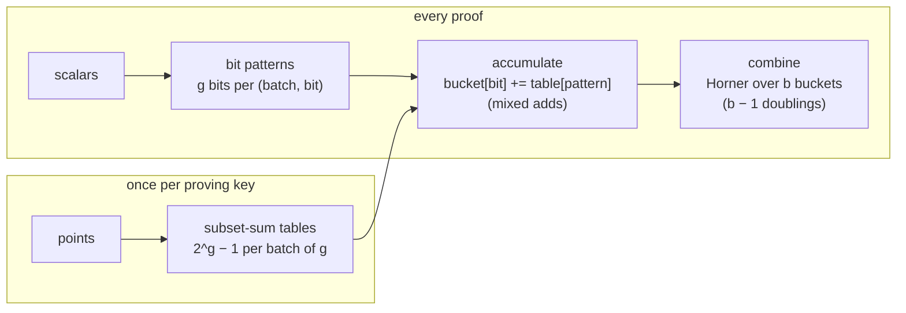
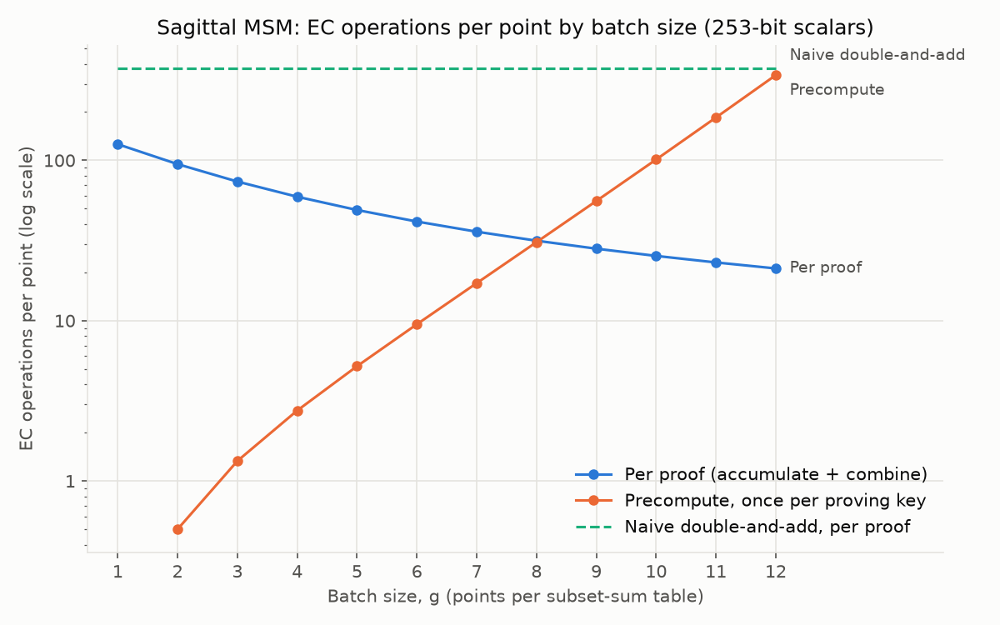

# 3. Sagittal MSM

[Docs index](README.md) · Previous: [2. Pippenger](2-pippenger.md) · Next: [4. Why it suits GPUs](4-gpu.md)

The sagittal plane divides a body into left and right. Sagittal MSM divides the scalar bit
matrix the other way from Pippenger: instead of strips c bits wide and n rows tall, it uses
blocks **1 bit wide and g rows tall**.


## The idea

Take a batch of g points `P_1 … P_g` and look at one bit position i of their g scalars. Those g
bits form a pattern m, and the points whose bit is 1 sum to a **subset sum** of the batch:

```
S[m] = Σ { P_t : bit t of m is 1 }
```

That subset sum depends only on the points, not on the scalars. The points are fixed for every
proof of a circuit (they are the proving key), so **every subset sum of every batch is computed
once and stored**. Each proof then needs one table lookup and one addition per (batch, bit):

```
PREPARE (once per proving key)
  split the points into batches of g
  for each batch: build all 2^g − 1 nonempty subset sums, normalize them

MSM (every proof)
  bucket[0 … b−1] = empty                      one bucket per scalar bit
  for each batch j, for each bit i:
      m = the g scalar bits at position i       (bit t of m = bit i of scalar t)
      if m ≠ 0: bucket[i] += table_j[m]         one mixed add
  result = bucket[b−1]
  for i = b−2 down to 0:                        Horner's rule: b−1 doublings in total
      result = 2·result + bucket[i]
```

Why it is correct: `Σ k_i·P_i = Σ_bits 2^i · (sum of the points whose bit i is 1)`, and bucket i
holds exactly that sum. The final loop is Horner's rule over the b buckets.



## A worked example

Four points A, B, C, D in batches of g = 2, with 4-bit scalars 13, 6, 9, 3. The tables are
`{A, B, A+B}` and `{C, D, C+D}`.

| bit | k1 k2 (13, 6) | lookup | k3 k4 (9, 3) | lookup | bucket |
|---|---|---|---|---|---|
| 3 | 1 0 | A | 1 0 | C | A + C |
| 2 | 1 1 | A + B | 0 0 | — | A + B |
| 1 | 0 1 | B | 0 1 | D | B + D |
| 0 | 1 0 | A | 1 1 | C + D | A + C + D |

```
result = 8(A + C) + 4(A + B) + 2(B + D) + (A + C + D) = 13A + 6B + 9C + 3D   ✓
```

This example is a test: `tests/test_msm.py::test_worked_example`.

## Building a table with one addition per entry

Store the subset with bitmask `c + 1` in slot c. The expression `d = c & (c + 1)` clears the
trailing 1-bits of c, which splits the mask into two smaller masks that are already built:

```python
for c in range(2**g - 1):
    d = c & (c + 1)
    table[c] = table[c - d] + table[d - 1] if d else next_point()
```

For g = 3:

| slot | mask | subset | built as |
|---|---|---|---|
| 0 | 001 | P1 | point |
| 1 | 010 | P2 | point |
| 2 | 011 | P1 + P2 | slot 0 + slot 1 |
| 3 | 100 | P3 | point |
| 4 | 101 | P1 + P3 | slot 0 + slot 3 |
| 5 | 110 | P2 + P3 | slot 1 + slot 3 |
| 6 | 111 | P1 + P2 + P3 | slot 0 + slot 5 |

That is `2^g − 1 − g` additions per batch, the minimum possible.

## Cost

With b-bit scalars and n points in n/g batches:

| | Curve operations | Notes |
|---|---|---|
| Per proof, accumulate | `b · (n/g) · (1 − 2^−g)` mixed adds | a pattern is zero with probability 2^−g |
| Per proof, combine | about b doublings and b adds | about 500 operations in total, independent of n |
| Once, prepare | `(n/g) · (2^g − 1 − g)` full adds | plus normalizing every entry |
| Memory | `(n/g) · (2^g − 1)` points | (2^g − 1)/g points per input point |

Measured per-proof curve operations per point at 253-bit scalars (n = 4,096):

| g | 1 | 4 | 7 | 8 | 10 | 12 |
|---|---|---|---|---|---|---|
| Per proof | 126.0 | 59.3 | 35.9 | 31.5 | 25.3 | 21.2 |
| Precompute | 0 | 2.8 | 17.1 | 30.9 | 101.2 | 339.9 |
| Table size (× n points) | 1.0 | 3.8 | 18.1 | 31.9 | 102.2 | 340.9 |



The per-proof count falls as g grows; the one-time precompute and the table grow as 2^g / g.
Notice what is missing compared with Pippenger: **there is no bucket reduction**. There are only
b buckets, and combining them costs about 500 operations however large n is.

With g = 1 there is no precompute at all: each point is its own table, and the algorithm is a
bit-sliced double-and-add with all doublings shared. That was the first version, found in 2022.

## Relation to known algorithms

- One batch on its own is **Straus's method** (also called Shamir's trick): simultaneous
  multi-exponentiation with a table of all 2^g subset products of g bases.
- Precomputing from fixed bases is the idea behind fixed-base methods such as Lim–Lee combs.
- Pippenger's windowing is the general frame for both.

Sagittal combines these in a particular way:

- it slices bit-major: one bucket per scalar bit, across all batches at once;
- it builds the subset-sum tables offline from a fixed proving key;
- every bucket's work is fixed before any scalar is seen;
- nothing is left to reduce after accumulation.

The [next page](4-gpu.md) shows why that combination maps so well to a GPU, and
[the results](5-results.md) show what it costs.
