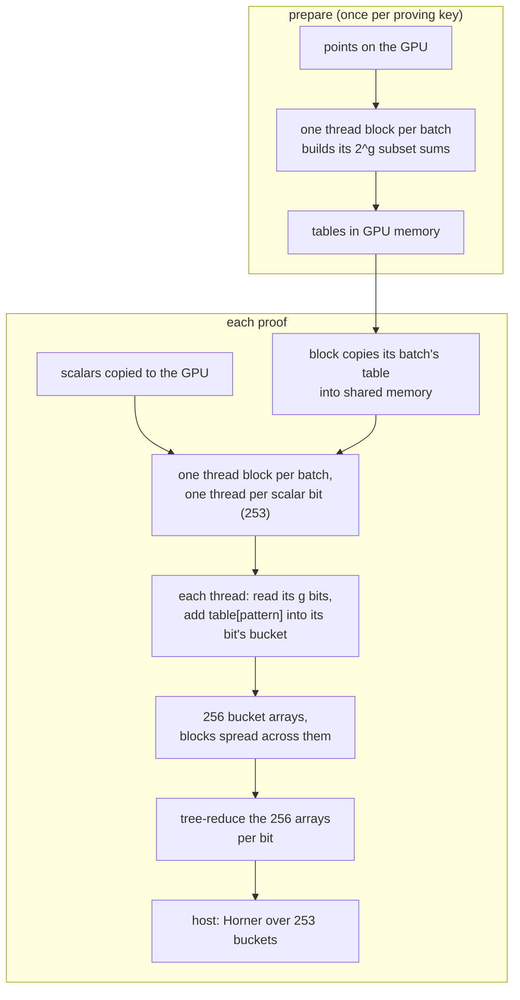
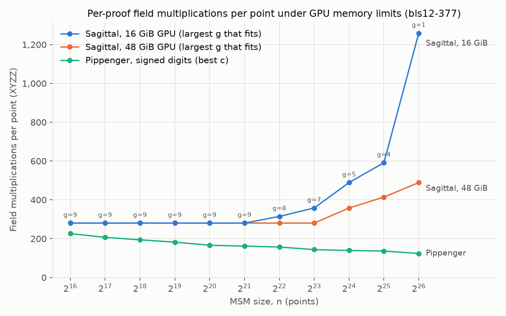

# 5. Why Sagittal suits GPUs

[Docs index](README.md) · Previous: [4. Sagittal](4-sagittal.md) · Next: [6. Results](6-results.md)

At 2^20 points Sagittal does more curve operations than a well-tuned Pippenger
([results](6-results.md)). It still ran faster on GPUs in 2023, because of how its work is
shaped. This page describes the CUDA design built at Sindri Labs. The CUDA code is not in this
repository; the Python implementation here follows the same algorithm.

## Design goals

The 2023 write-up,
[Sagittal MSM: a streamlined MSM implementation](https://medium.com/@sindrilabs/sagittal-msm-a-streamlined-msm-implementation-a9dcc07da585),
listed what the design was for. With what this repository measures:

- **A simple, deterministic order of bucket updates.** Each bucket belongs to one scalar bit, and
  every bucket's work is known before any scalar is read. There are no conflicts to detect, so
  none of the queues and schedulers that Pippenger needs on a GPU
  ([2. Big numbers and GPUs](2-hardware.md)). One refinement: the fastest kernel, `atomic`,
  spreads blocks across 256 copies of the buckets and locks a copy while adding into it. That
  order is fixed by block number, not by the data.
- **No double-and-add.** No point is ever multiplied by its scalar; the only per-proof work is
  table lookups and additions.
- **Projective coordinates in Montgomery form** for the field arithmetic
  ([2. Big numbers and GPUs](2-hardware.md)). Precisely: the benchmarked kernel kept buckets in
  Jacobian coordinates (a weighted projective form, using [sppark](https://github.com/supranational/sppark)'s field and point types) and
  stored table entries as affine points, so every lookup was a mixed add.
- **About 2^8 buckets instead of 2^20.** Sagittal holds 253 buckets, against 983,040 for a
  tuned signed-digit Pippenger at 2^20 points. That is over three orders of magnitude fewer. With
  so few buckets, combining them costs about 500 operations, so finished buckets go back to the
  CPU and are combined there. On an FPGA this frees on-chip memory (block RAM), because the
  combining logic doesn't have to live on the device.
- **Precomputed point additions.** The subset-sum tables are built once for every proof that
  shares a proving key. They make the stored key bigger, costing device memory or transfer
  bandwidth, so the batch size g is a tunable parameter.

## Shape of the work at 2^20 points

At 2^20 points on BLS12-377 (closed-form model, `benchmarks/results/structure.md`):

| | Sagittal (g = 7) | Pippenger, signed (c = 17) | Precomputed windows (Yrrid config) |
|---|---|---|---|
| Buckets held | 253 | 983,040 | 8,388,608 |
| Points per bucket, mean / max | 148,410 / 148,720 | 16 / 87 | 1.4 / 149,935 |
| Curve ops after accumulation | 504 | 1,873,466 | 14,636,820 |

- **Few buckets, all equally loaded.** Sagittal holds one bucket per scalar bit: 253. Every
  bucket gets one table lookup per batch, so the loads are fixed by n and g before any scalar is
  read. The largest is within 0.2% of the mean. There is nothing to sort and no heavy bucket to
  split.
- **Almost nothing after accumulation.** Combining 253 buckets is about 500 operations, so all
  of the work is in the accumulation, which parallelizes cleanly.
- **Cheap additions.** Every accumulation step adds a stored, normalized table entry: a mixed
  add, 10 field multiplications in XYZZ. Pippenger's reduction uses full adds at 14.
- **Regular memory access.** A batch's whole table is read by the threads working on that
  batch, so it can sit in fast on-chip shared memory.

## The kernel

Sindri's fastest version, `atomic`, maps the algorithm like this:

- **Thread = bit, block = batch.** Every thread in a block does the same work (one lookup and one
  addition), so warps never diverge. The kernel even adds the identity for an all-zero
  pattern rather than branch.
- **Shared memory.** A batch's table has 2^g entries of 96 bytes on BLS12-377. The default 48 KB
  of shared memory per block fits g ≤ 9, which is why no run used more than 9.
- **Bucket arrays.** Blocks add into 256 copies of the 253 buckets, chosen by block index, so
  thousands of blocks don't contend for one array. The copies are summed per bit at the end.

## The catch: memory

The tables hold (2^g − 1)/g points per input point. A larger g means less work per proof but a
table that grows exponentially, so the largest g that fits shrinks as n grows. The model in
[`memory.py`](../src/sagittal_msm/memory.py) counts input points, scalars and tables. It
reproduces the batch sizes of the logged runs on a 16 GiB V100: **g = 8 at 2^22 and g = 5 at
2^24**, the largest that fit.

Below 2^22, shared memory caps g at 9 and Sagittal's cost per point is flat. Above it, memory
forces g down and the cost rises, while Pippenger's keeps falling. That is where the 2023 GPU
results stop favoring Sagittal ([results](6-results.md)).

[Docs index](README.md) · Previous: [4. Sagittal](4-sagittal.md) · Next: [6. Results](6-results.md)
