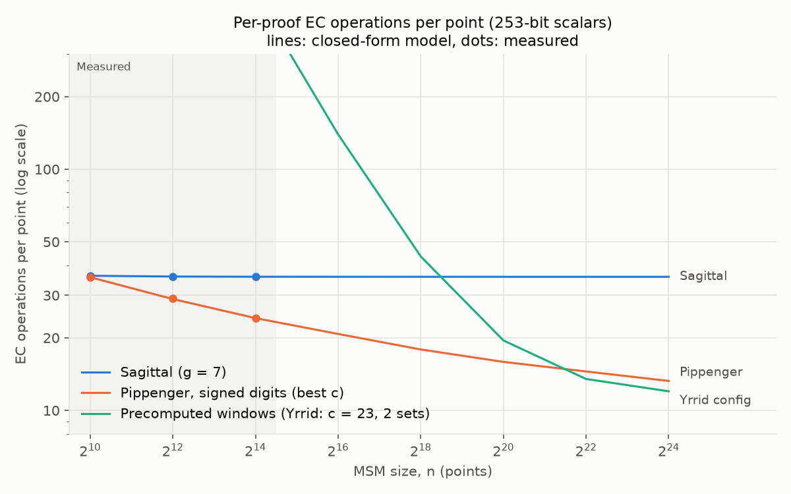

# 5. Results

[Docs index](README.md) · Previous: [4. Why it suits GPUs](4-gpu.md) · Next: [6. Methodology](6-methodology.md)

## On GPUs (2023)

On BLS12-377 at 2^20 points, with the proving key precomputed once and reused across proofs,
Sagittal ran an MSM in 64 ms: 1.7× faster than every ZPrize 2022 GPU entry that runs on a V100,
and faster than all entries but one (Yrrid, 48 ms) on an A10G.

How these were measured (May 2023, one GPU, one MSM per timed run):

- The competitors are the
  [ZPrize 2022 GPU MSM entries](https://github.com/z-prize/2022-entries/tree/main/open-division/prize1-msm/prize1a-msm-gpu),
  run with their own benchmark harness. Each entry's one-time setup (copying points, and for
  Yrrid and MatterLabs + Yrrid, precomputing shifted points) runs before timing starts, the same
  way Sagittal's table build does.
- Sagittal is Sindri's CUDA `atomic` kernel with g = 7.
- Yrrid and MatterLabs + Yrrid (the ZPrize winners) require Ampere GPUs, so they did not run on
  the V100.

All logged sizes, including where Sagittal lost: [`benchmarks/results/gpu_2023.md`](../benchmarks/results/gpu_2023.md).

- At 2^22 on the V100, Sagittal (248 ms) trails 6block and Trapdoor-Tech (217 and 220 ms).
- On the A10G at 2^22 and 2^24, the `atomic` kernel failed with a memory error. The only valid
  Sagittal runs there used an earlier kernel, and they were 6× and 9× slower than Yrrid.

## Operation counts

Per-proof curve operations per point, 253-bit scalars, one-time precompute excluded. Lines are
the closed-form model; dots are measured runs, which match it within 2%:

| Per point | 2^12 | 2^16 | 2^20 | 2^24 |
|---|---|---|---|---|
| Sagittal (g = 7) | 35.9 | 35.8 | 35.8 | 35.8 |
| Pippenger, signed digits (best c) | 28.9 | 20.8 | 15.9 | 13.3 |
| Precomputed windows (Yrrid config) | 2,059 | 139.1 | 19.1 | 11.6 |

**Sagittal does more curve operations than a tuned Pippenger at these sizes.** Its count is flat
in n (b(1 − 2^−g)/g lookups per point), while Pippenger's best window grows with n and its cost
per point falls. So the GPU result above is not "fewer operations".

## Weighted by field cost

Sagittal's operations are almost all cheap mixed adds; Pippenger's reduction is full adds.
Weighting each operation by its field multiplications (XYZZ) narrows the gap:

| Per point at 2^20 | Curve ops | Field mults |
|---|---|---|
| Sagittal (g = 7) | 35.8 | 358 |
| Precomputed windows (Yrrid config) | 19.1 | 247 |
| Pippenger, signed digits (c = 17) | 15.9 | 166 |

Against the Yrrid configuration on the same A10G:

| | Sagittal ÷ Yrrid config |
|---|---|
| Curve operations | 1.87× more |
| Field multiplications | 1.45× more |
| Measured time | 1.33× slower (64 vs 48 ms) |

Field cost explains most of the gap. The rest is the structure described in
[4. Why it suits GPUs](4-gpu.md): few equally loaded buckets, nothing left to reduce, and tables
in shared memory. Those let Sagittal do each field operation faster.

## One-time precompute

Both Sagittal and the ZPrize winners precompute from the fixed points. Field multiplications per
point per proof, when one precompute serves K proofs (2^20 points):

| | K = 1 | K = 10 | K = 100 | K = 1,000 |
|---|---|---|---|---|
| Sagittal (g = 7) | 743 | 397 | 362 | 358 |
| Precomputed windows (Yrrid config) | 2,357 | 458 | 268 | 249 |
| Pippenger, signed digits | 166 | 166 | 166 | 166 |

- **Sagittal's table is about 5× cheaper to build** than the Yrrid configuration's shifted
  points: 385 field multiplications per point against 2,110.
- **The Yrrid configuration only costs less per proof above 16 proofs per proving key.**
- **Plain Pippenger** needs no precompute and does the fewest field operations at every K.
  Its disadvantages are structural, not arithmetic.

## Memory

Sagittal's batch size is limited by GPU memory and shared memory
([4. Why it suits GPUs](4-gpu.md)). The model reproduces the logged V100 batch sizes and shows
where the trade-off turns: on a 16 GiB GPU, per-proof field multiplications per point are flat at
280 up to 2^21 (g = 9). They rise to 489 at 2^24 (g = 5), where Pippenger needs 139.

## Summary

- **Where Sagittal wins:** small and medium MSMs (up to about 2^20) on GPUs. Its regular,
  reduction-free work lets each operation run faster than in bucket methods.
- **Where it loses:** large MSMs, where memory forces small batches. Also raw operation counts:
  a tuned Pippenger always does fewer.
- **Every number here can be regenerated** with `task bench-full` ([methodology](6-methodology.md)).
