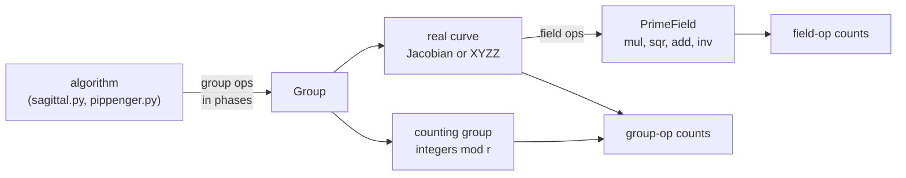

# 7. Methodology

[Docs index](README.md) · Previous: [6. Results](6-results.md)

How every number in these docs is produced, and what it does not cover.

## Counting

Algorithms never count anything themselves. They call group operations (`add`, `add_mixed`,
`double`, `neg`, `batch_normalize`) inside named phases, and the group records each call:

```python
with group.counter.phase("accumulate"):
    bucket = group.add_mixed(bucket, entry)
```

So the counts always describe the code that ran. Phases are `prepare` (once per proving key),
`accumulate`, `reduce` and `combine` (every proof).



## Two kinds of group

- **The counting group.** An elliptic-curve subgroup of prime order r has the same structure as
  the integers mod r under addition. Every algorithm here uses only group operations, so running
  it on integers mod r gives exactly the same operation counts as on a curve, without the curve
  arithmetic. That makes large runs practical in Python.
- **Real curves.** BN254, BLS12-377 and a test curve over the 64-bit Goldilocks field, in
  Jacobian or XYZZ coordinates. They also count field operations, and the tests check that
  every phase's field operations equal its group operations times the cost table in
  [`costs.py`](../src/sagittal_msm/costs.py).

Every algorithm is checked against a reference answer on every group, for many sizes and edge
cases. Curves are swappable by name, e.g. `--group bls12-377-xyzz`.

**Goldilocks.** No curve y² = x³ + b over p = 2^64 − 2^32 + 1 has prime order: all six
possible orders are composite.
[`scripts/find_goldilocks_curve.py`](../scripts/find_goldilocks_curve.py) shows this and picks
b = 11, with order 2^64 + 3 = 467443687 × r and a 36-bit prime subgroup. Field elements fit in a
uint64; scalars are 36 bits.

## The closed-form model

Python can't run 2^24-point MSMs in reasonable time, so
[`model.py`](../src/sagittal_msm/model.py) predicts every phase's expected operation count.

- **Scalar bits.** Uses the exact bit probabilities of a uniform scalar below r. For BLS12-377
  the top bit is set only 15% of the time.
- **Window digits.** Exact, by a trick: signed digits in [−(2^(c−1)−1), 2^(c−1)] are the ordinary
  base-2^c digits of k + H, shifted down by 2^(c−1) − 1, where H is a constant. Since k + H is
  uniform on an interval, every window's digit distribution follows by counting.
- **Bucket occupancy.** Poisson, over piecewise-constant hit rates, so configurations with
  millions of buckets evaluate in milliseconds.

Tests check the model against measured counts:
- every phase within 2% across many configurations;
- per-window digit histograms against digits extracted from 20,000 scalars;
- bucket loads against loads extracted from 16,384 scalars.

The comparison benchmark re-checks measured against model on every run up to 2^14.

## Memory model

[`memory.py`](../src/sagittal_msm/memory.py) assumes values in whole 64-bit limbs:

| BLS12-377 | Bytes |
|---|---|
| Affine point | 96 |
| XYZZ accumulator | 192 |
| Scalar | 32 |

Device memory includes the input points, one proof's scalars, and precomputed data. GPU sizes
are in GiB. The shared-memory limit assumes the 48 KB default per block.

## Limitations

- **Operation counts are not running times.** They don't capture memory traffic, scheduling,
  or how well each algorithm uses the GPU. That is the point of [5. Why it suits GPUs](5-gpu.md).
- **The Yrrid configuration is an approximation** of Yrrid's code: c = 23, signed digits, 2 bucket
  sets. It does not model their trick of negating scalars with the top bit set, their bucket
  sorting, or their exact number of precomputed copies.
- **Window sizes c are chosen** to minimize curve operations, not field multiplications.
- **Not modeled:** the GLV endomorphism, which halves the scalar length on BN254 and BLS12-377
  and helps every algorithm here.
- **GPU numbers are from 2023 logs.** The ZPrize entries were timed with criterion (median of
  repeated runs); Sagittal and sppark with a single timed run of Sindri's `msm_bench`.

## Reproducing

```sh
uv sync                 # install
task py-test            # the test suite, about 20 s
task bench-full         # regenerate benchmarks/results/ (about 30 s)
uv run python scripts/make_figures.py      # docs/figures/
uv run python scripts/find_goldilocks_curve.py
```

[Docs index](README.md) · Previous: [6. Results](6-results.md)
